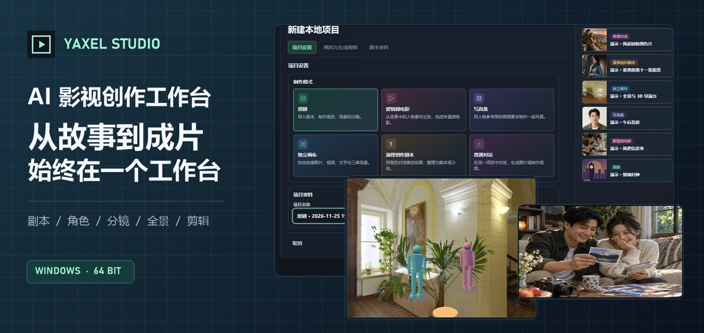
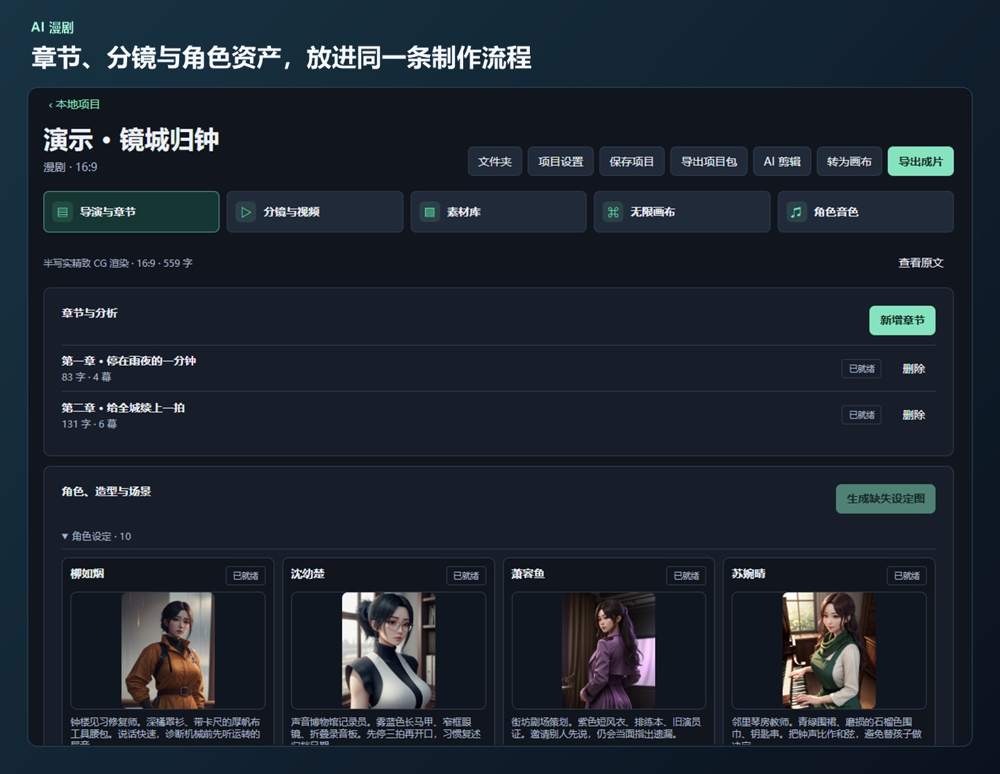
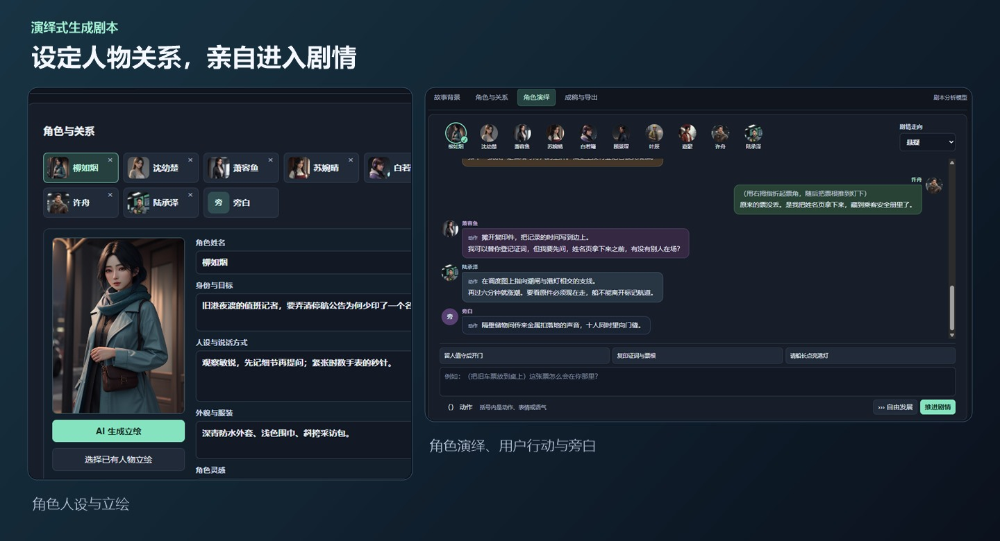
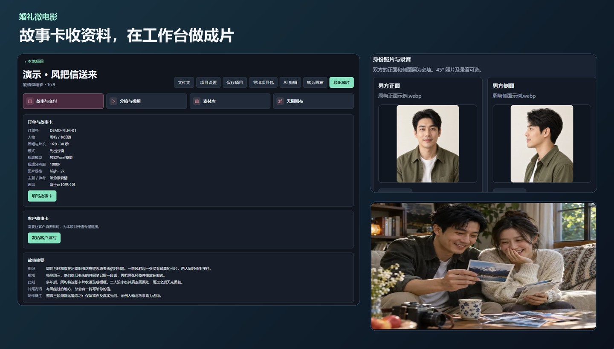
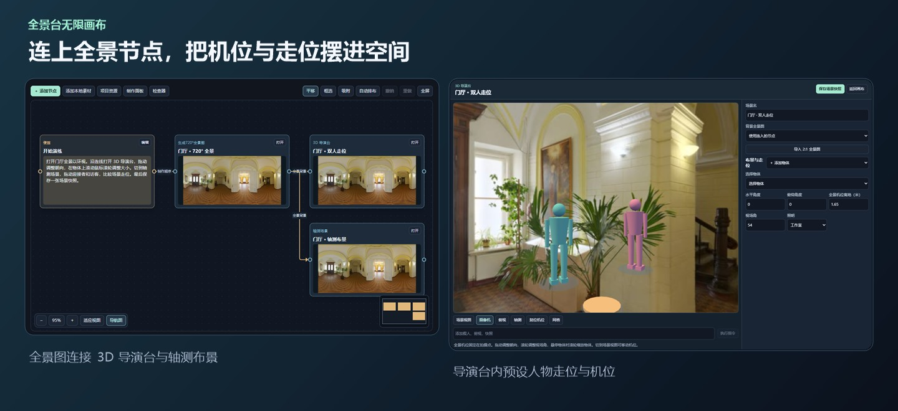
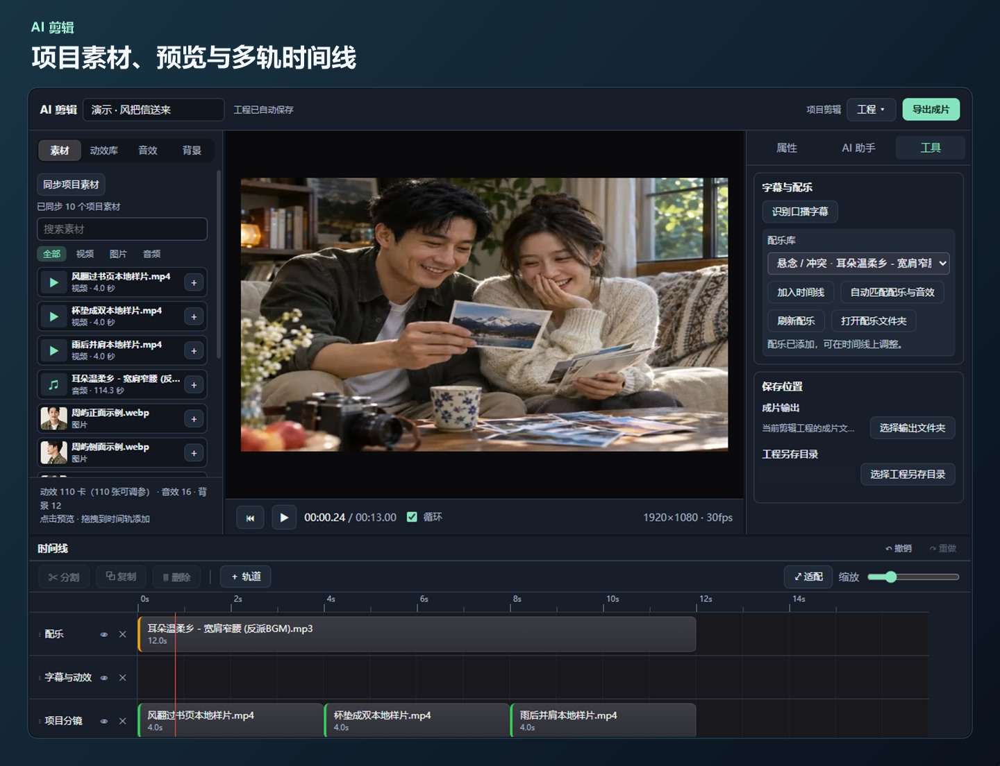
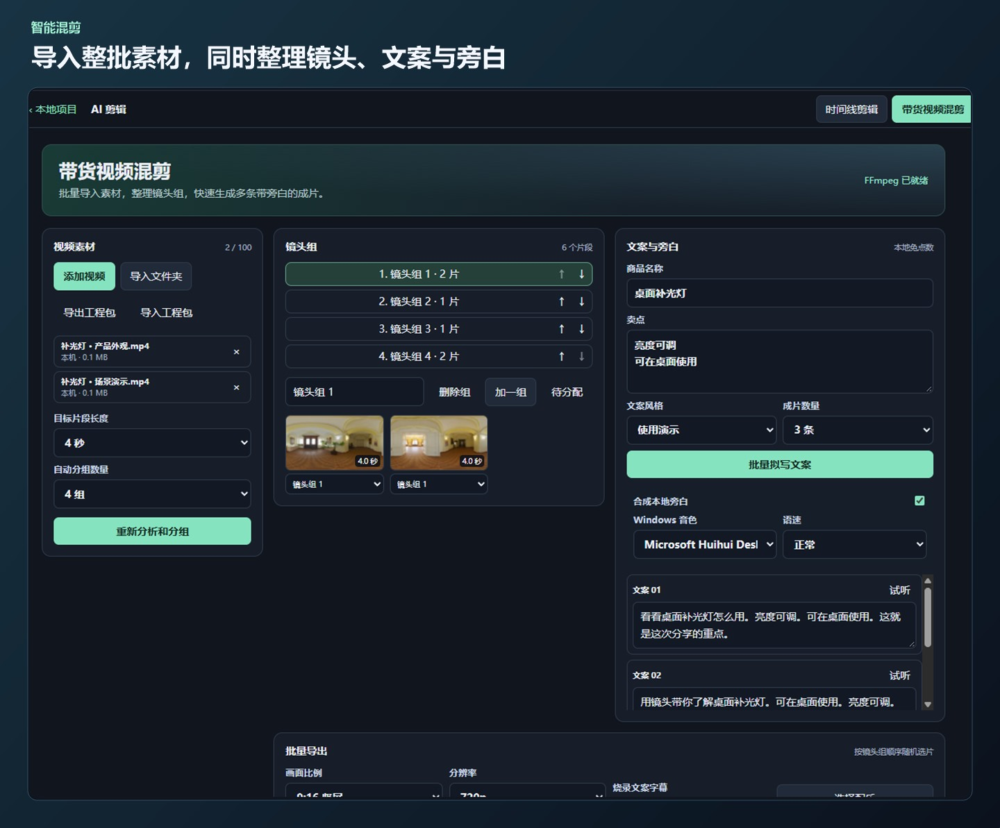
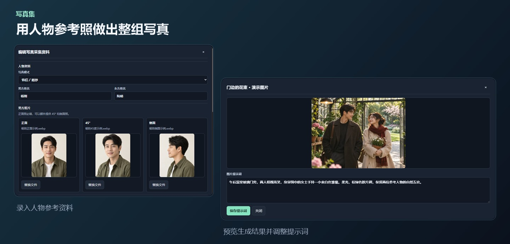
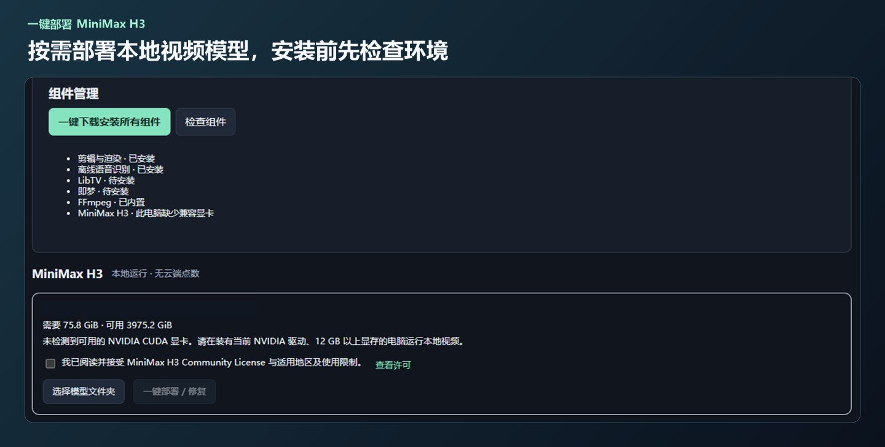
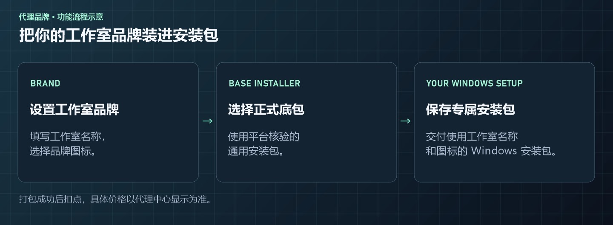

# Yaxel Studio

**把 AI 影视的天花板，搬到你的桌面。**

从第一句角色对白到最后一帧成片，所有制作环节都在同一个工作台接力。

**AI 漫剧 · 演绎式生成剧本 · 婚礼微电影 · 全景台无限画布**

**AI 剪辑 · 智能混剪 · 写真集 · MiniMax H3 一键部署**

[下载 Windows 安装包](https://github.com/ypy0612/yaxel-studio/releases/latest) · [查看版本记录](https://github.com/ypy0612/yaxel-studio/releases) · [查看八大核心功能](#核心功能)

在多个工具间搬运剧本、立绘、走位和素材，最容易拖慢制作。Yaxel Studio 让这些信息跟着作品走。角色能进分镜，分镜能进画布，画面和声音能直接落到时间线。

用本地项目管理素材、镜头和成片，按需调用在线模型。登录就能打开六个内置演示，从角色创作、全景调度到多模态对话，每条流程都可以直接上手。

## 核心功能

### AI 漫剧｜把长剧本拆成一条可控的生产线

长篇改编最难的，是往后写十章，人物、场景和镜头仍能对得上。Yaxel Studio 把章节、角色设定、场景、道具、对白、分镜和视频都放在同一个项目里。

- **长剧本能分批做。** 支持拆分章节、按章分析，处理长稿时可以先集中打磨关键章节。
- **角色能沿用。** 维护立绘、声音和角色资料，在对白中快速选择说话人，按角色试听音色。
- **镜头能精修。** 在分镜中切换视频模型及参考模式。键入 `@` 筛选和预览图片、视频或音频，再把素材插入提示词。点开设定图或分镜图即可修改提示词、替换和重新生成。

### 演绎式生成剧本｜先让人物活起来，再把剧情写成戏

人物只停留在设定表里，很难写出真实反应。建立世界、角色和人物关系后，你可以亲自扮演其中一人，由系统根据人设和发生的事件接住下一轮剧情。

- **一个灵感就能开场。** 生成背景、角色设定和立绘，也能从其他本地剧本带入人物、立绘以及所选人物间的关系。
- **对白有戏。** 点击角色切换视角，用括号输入动作。系统依据场上关系判断谁发言，生成对白、内心独白、行为、神态和语气，也能让旁白推进场景。
- **每轮都有积累。** 将全部演绎整理成分场剧本或小说，可把剧本和人物素材接到漫剧或无限画布继续制作。

### 婚礼微电影｜把客户的真实经历拍成自己的故事

客户故事散在聊天记录、表单和照片里，真正开拍前往往还要来回补资料。Yaxel Studio 把收集、创作和剪辑串成一个订单流程。

- **一张故事卡收齐创作资料。** 建单时先确定画幅，再选画风和播放场合，填写人物与相识、相知等细节。也能把故事卡链接发给客户，由客户补全经历和参考照。
- **故事落到每个镜头。** 围绕新人经历选择纪实或剧情方向，逐镜调整画面、对白和视频。婚礼大屏、纪念日播放等场景可各自设定。
- **成片跟着项目走。** 打开剪辑即可带入分镜成片与素材，完成音乐、字幕和交付。

### 全景台无限画布｜先看清整个景，再决定这一镜怎么拍

平面参考图能交代风格，空间关系和机位仍需要自己推演。全景台把 720° 球面全景、3D 导演台、轴侧场景和素材节点连进同一张可全屏的画布。

- **从一张图进入空间。** 可用平台模型生成 2:1 全景图，也可导入已有全景。全景节点可连接导演台和轴侧场景。
- **按导演的方式调度。** 切换机位、俯视或轴侧视图，拖动人物和道具安排走位，用滚轮调整对象大小或视场角。保存快照后可回到画布继续引用。
- **构思能直接变成镜头。** 图片、视频、文字、音频和生成节点可以拖放、连线、框选和自动排布。可把漫剧或微电影分镜与人物资产一起导入，保留镜头与素材的对应关系。

### AI 剪辑｜分镜做完，时间线已经等着你

把分镜逐个下载再导入剪辑软件，会丢掉镜头顺序和素材上下文。Yaxel Studio 的 AI 剪辑在主窗口打开，从制作项目进入时自动同步素材，并把已有的分镜成片放到时间线。

- **制作和剪辑接得上。** 图片、视频和音频一起进入素材栏，分镜保持制作顺序，也可以独立打开剪辑工作区导入本机文件。
- **建议由你决定。** AI 剪辑建议可以先预览再应用。时间线支持分割、配乐、字幕和输出，并可导入自己有权使用的配乐。
- **工程和成片都能带走。** 支持 MP4 导出、包含素材的剪辑工程导入导出，并保留继续编辑的时间线。

### 智能混剪｜一批素材，做成多条有差异的带货片

素材越多，手动找镜头、剪片段和拼接的成本越高。智能混剪把这段工作交给本机处理，创作者集中决定卖点、镜头顺序和旁白。

- **先拆片，再按内容选。** 批量导入视频或整个文件夹，由 FFmpeg 检测镜头并切片，自动分组后可以预览和手动调整。首次使用可在组件管理中按需安装 FFmpeg。
- **一套卖点，多条旁白。** 输入商品与真实卖点，批量生成可编辑文案，用本地语音试听并确认字幕。
- **保留顺序，批量出片。** 按镜头组的顺序抽取不同片段，生成多条有差异的 MP4 和字幕。切片、模板旁白和成片合成走本地流程。

### 写真集｜让人物参考照和每张成片建立对应关系

写真项目最费时间的通常是反复整理参考角度、场景要求和客户反馈。写真集流程把这些信息留在同一份项目里，逐张校对更直观。

- **以人物参考照开工。** 收集清晰的正脸和所需角度，选择参考样片或填写场景要求。
- **逐张掌控方案。** 使用固定的 Midjourney V8.2 Turbo 写真流程，点开大图核对人物和画面，调整提示词、替换图片或重新生成。
- **交付和复审可追踪。** 可整理独立方案，还可按项目交付需求处理动态写真、保存本地文件。

### MiniMax H3 一键部署｜把兼容电脑变成本地视频生成机

本地视频模型的第一道门槛往往是驱动、运行组件、权重和路径。Yaxel Studio 在组件设置中提供硬件与空间检查、按需下载、已有模型校验和一键部署或修复。

- **按需下载。** 安装包无需预置数十 GiB 权重。部署前可选择磁盘，模型下载后留在本地，已有通过校验的权重可以复用。
- **直接接进创作。** 在支持的项目中选择 MiniMax H3，使用纯文字、首尾帧或多素材参考，生成结果保存回本地项目。
- **本地推理不扣平台点数。** 适用于兼容的 NVIDIA CUDA 环境。模型需单独接受 MiniMax H3 Community License，硬件、磁盘需求与许可范围以部署页和官方许可为准。

## 代理品牌｜把同一套制作能力，交到你的客户手里

开通代理后，可以用自己的工作室名称和图标制作 Windows 安装包。客户首次运行就能在登录和注册页面看到工作室品牌，开通代理的账号登录后也会同步对应的站点名称和图标。

- **用自己的名字交付。** 在代理中心设置工作室品牌，选择平台核验的正式底包，生成独立的品牌安装包。当前每次成功封装结算 50 点。首次同步工作室图标或制作品牌包前，在组件管理中安装 FFmpeg。
- **覆盖更新保留品牌。** 通用更新覆盖安装时保留已设置的工作室名称与图标，并沿用正常的项目和组件路径。
- **从邀请到售后有统一入口。** 客户可通过代理邀请码注册。软件内的客服与帮助可呈现站点设置的链接或二维码。

## 下载安装

1. 从 [Releases](https://github.com/ypy0612/yaxel-studio/releases/latest) 下载 `Yaxel-Studio-3.14.0-Windows-x64-Public-Setup.exe`，并用同页的 SHA-256 校验文件核对安装包。当前安装包未进行 Windows 代码签名，系统可能显示未知发布者。
2. 双击安装，选择语言和安装位置。覆盖安装识别原目录并保留已有组件。安装完成后可从桌面快捷方式启动。
3. 注册时使用邀请码 `yaxel`，或填写工作室提供的专属邀请码。登录后可从「开始」打开六个演示项目。
4. 按需在「设置 → 组件管理」补齐 FFmpeg、剪辑、字幕、第三方画布和 MiniMax H3 组件。

## 下载与使用说明

- **系统**　Windows x64。项目工作区和按需部署的模型可以选择其他盘符。
- **本地与在线**　项目及其素材保存在本机。账号、充值、线上故事卡和平台模型需联网。调用平台模型按产品内报价结算。

- **发布内容**　安装包和 SHA-256 校验文件可在 Releases 下载。GitHub 自动生成的 ZIP 和 TAR.GZ 只包含产品介绍和配图。
- **第三方许可**　软件的部分解包功能使用 Igor Pavlov 的 7-Zip 21.07，按 GNU LGPL 授权。参见 [7-Zip 官网](https://www.7-zip.org/) 和 [21.07 源代码](https://sourceforge.net/projects/sevenzip/files/7-Zip/21.07/7z2107-src.7z/download)。

---

**从角色开口，到世界成形，再到成片落地。把你的下一部作品放进 Yaxel Studio。**

[下载 Yaxel Studio](https://github.com/ypy0612/yaxel-studio/releases/latest)
